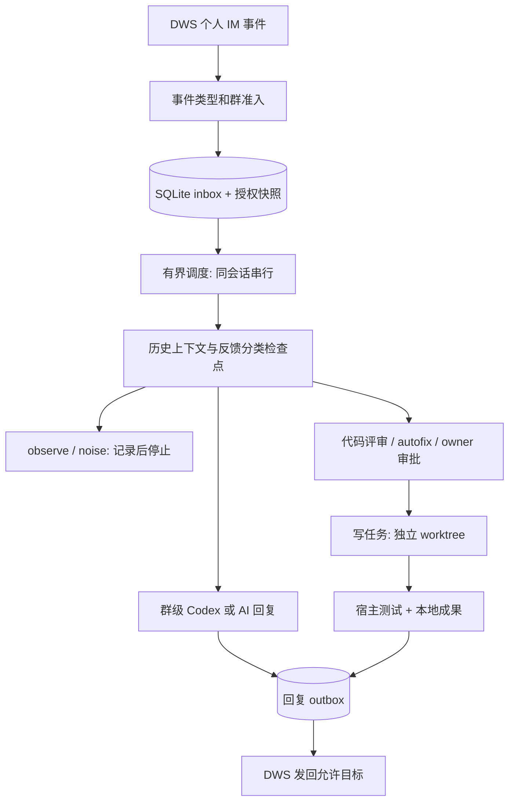

# Dingding Me Agent 0.2.0 当前架构与边界

本文描述 0.2.0 的本地实现契约，验收项是检查要求，不代表已完成真实群消息、生产服务
或发布验收。安装和字段说明见 [README](../README.md)，运行细节见
[Worker guide](worker.md)，中断处理见 [恢复说明](runtime-recovery.md)。

## 目标与实体

服务以 DWS 当前个人用户接收白名单群消息，完成咨询回复、反馈分类、代码评审和
受控本地修改。DWS 负责认证、事件连接、历史读取和消息发送；Codex CLI 负责群会话
及代码子任务。服务不自动提交、推送、合并或发布。

| 实体 | 当前载体 | 含义 |
| --- | --- | --- |
| GroupConfig | 配置 JSON / Python dataclass | 群、项目、仓库、owner、模式和发送/执行策略 |
| Job | SQLite `jobs` | 已接收事件、profile/会话 lane、处理路由和授权快照 |
| Step | SQLite `steps` | 一个已开始或完成的处理步骤及其结果 |
| Outbox | SQLite `outbox` | 普通回复的固定 UUID、目标、正文、策略和投递结果 |
| ClassificationResult | 结构化分类 / task bundle | 类型、置信度、代码需求、风险和验收要求 |
| Pending approval | 每群 JSON 中按任务 ID 保存 | 多个待 owner 确认请求及原始授权范围 |
| Codex session | 每群 `session.json` 和日志 | thread ID 与 Codex 会话上下文 |
| Code task | 任务目录 / worktree / 结果 JSON | 本地代码执行、验证输出和待发布结果 |

Job 不是完整工单产品；没有独立的 Ticket/Assignment 生命周期、跨群订阅图或每任务
持久 Codex session。群连续对话仍以 conversation ID 关联 Codex thread。

## 数据流

每个启用群按 trigger 建立 listener；mention + approval 另建仅处理确认的群 listener。
入口仍是 `dws event consume --flatten -f ndjson`，不轮询历史替代事件流。

SQLite 对同一 profile/会话中的重复消息做持久去重；旧 `seen.jsonl` 继续参与过滤。
默认 3 个 worker，可通过 `--max-workers 1–32` 调整；一个 lane 不会同时执行两条事件。
短入库操作后释放 intake 锁，模型、代码和测试运行在调度线程中。

## 准入、授权与模式

群准入、目标允许范围与 owner 身份由本地配置授予，消息正文、历史和模型输出不能
扩大发送或仓库授权。排队任务保存授权快照，执行前对比当前注册策略；变化后 blocked。
这不是对所有运行中子进程的即时撤权协议，也不自动取消已开始的外部动作。

| 路径 | 行为 |
| --- | --- |
| `observe` | 分类后结束，不生成回复、不启动 Codex；分类器本身可以调用 AI |
| `draft` | 生成本地草稿或任务材料；`reply_engine=codex` 会启动/恢复群 session |
| `guarded` 一般代码桥接 | 需要 `codex_execute=true` 和可用 repo，请求只读评审 |
| `autofix` 一般代码桥接 | `code_write_policy=auto`、执行 flag、明确 BUG、低风险、置信度达标、repo、测试命令同时满足后运行可写任务 |
| owner 确认代码任务 | approval policy、owner、明确请求、授权范围及执行 flag 必须匹配；不额外要求 autofix 模式 |

`send=false` 禁止普通回复实际发送，但不代表禁止本地模型调用。要关闭写代码能力，
使用 `code_write_policy=none` 或 `codex_execute=false`，不要只依赖 guarded 名称。
默认 `none` 同样阻止普通 autofix；`approval` 对 AI/Codex 两种回复引擎都先保存
pending 再等待 owner 确认，不因 autofix 模式而直接执行。

## 代码执行与验证

群回复新 session 和 resume 显式请求 Codex `read-only`；批准的代码任务及通过门禁的
普通 autofix 请求 `workspace-write`，在独立 Git worktree 中执行。

可写任务的 Codex 成功返回后，宿主在工作树运行配置的测试，并保存每条命令的
返回码、耗时、stdout/stderr 路径和 `verification.json`。测试失败使任务失败。
普通 autofix 必须有测试命令；批准任务若未配置测试，只能报告未完成测试验证。
Codex 退出零和模型自报 FIXED 都不等于线上验收。

宿主通过 shell 运行测试，不在 Codex sandbox 内。工作树和 CLI sandbox 参数不能
推广成全部工具、网络、绝对路径或测试命令都被本项目强隔离的保证。

## 多请求审批

每群 JSON 文件使用 version 2 的 pending map，兼容读取旧版单请求文件。请求 ID 为
`dws-codex-` 加 20 位哈希。owner 可回复 `确认 dws-codex-0123456789abcdef0123`。
无 ID 的确认只在恰有一个请求时执行；多个请求先要求选择。
正文须由完整配置确认词组成，可接受 `好的，继续`，拒绝 `不确认`、
`确认一下原因` 等否定或追问。

恢复不延长原 TTL，也不覆盖原授权。首次开始执行前检查过期；已有执行检查点时，
完成结果可继续用于交付，未知结果继续阻止重跑。后续确认不产生新的任务执行与
投递身份。普通回复先记 outbox，再调用 DWS，交付返回后才清除对应 pending。

## 中断语义

SQLite 数据库使用 WAL、FULL 同步和 `0600` 文件权限。数据库路径默认为
`Path(state_file).with_suffix(".sqlite3")`，支持 `--runtime-db`。进程持有该数据库
旁的锁；不同数据库之间没有共享锁或去重保证。

| 中断前状态 | 下次正常启动的处理 |
| --- | --- |
| job `running` | 回到 `queued`，重新核对路由和策略 |
| step `completed` | 复用已保存结果 |
| step `started` | 变为 `unknown`；再次触及时停止任务、等待人工回查 |
| outbox `sent` | 复用已确认发送结果 |
| outbox `sending` | 变为 `unknown`，禁止自动重发 |
| queued job 策略变化 / 路由消失 | blocked，不沿旧授权继续执行 |

运行中发送超时、非成功退出或无有效回执也可能产生 unknown。job 通常记录为 failed
并输出 attention 日志；step/outbox 的 unknown 是独立状态，不能由 job 计数推断。
没有恢复 CLI 或自动权威对账。重启恢复排队任务不等于允许重放未知副作用。

停止时保留队列，不继续启动积压任务；运行中的任务可在进程等待期间结束。强制
退出后由上述检查点阻止未知动作自动重放。可选 ready 招呼通过单独检查点保护，
失败或未知只记 attention，不阻塞收件箱启动。

## 本地验收要求

- 白名单外消息不进入 AI/Codex/发送；不同 listener 的重复消息不重复入库。
- 不同会话可并发，同一 lane 串行，停止保留未执行队列。
- 重启复用 completed，不自动执行 unknown；排队策略变化 blocked。
- 同群多个请求不互相覆盖，owner/任务 ID/授权范围和 TTL 正确约束执行。
- 普通 autofix 和批准写任务都在独立 worktree；配置测试失败不能报告验证通过。
- unknown 消息不通过重启或重复确认自动重发；ready 未知不阻塞 inbox 启动。
- `make check`、`make config-check`、`git diff --check` 通过。

服务安装、fresh listener、真实消息投递、模型供应方、真实代码成果和生产发布
仍需各自的实际证据；上述本地检查不能替代它们。

## 参考与后续边界

设计参考 DeepSeek 官方 [dsh-superagent-prototype](https://github.com/deepseek-ai/dsh-superagent-prototype)
的持久状态、有界 worker 和 outbox。该仓库是研究原型。这里继续保留 Python/DWS/Codex
CLI 与原 owner 门禁，没有迁入其 DSH 执行器、完整 Ticket/Assignment/订阅关系、
GitHub PR 生命周期或 Web 面板。

后续可独立设计人工对账/恢复命令、任务专属 session、追问归属和工作面板。当前
不将这些规划算作已实现功能，也不声明所有外部动作只发生一次。
